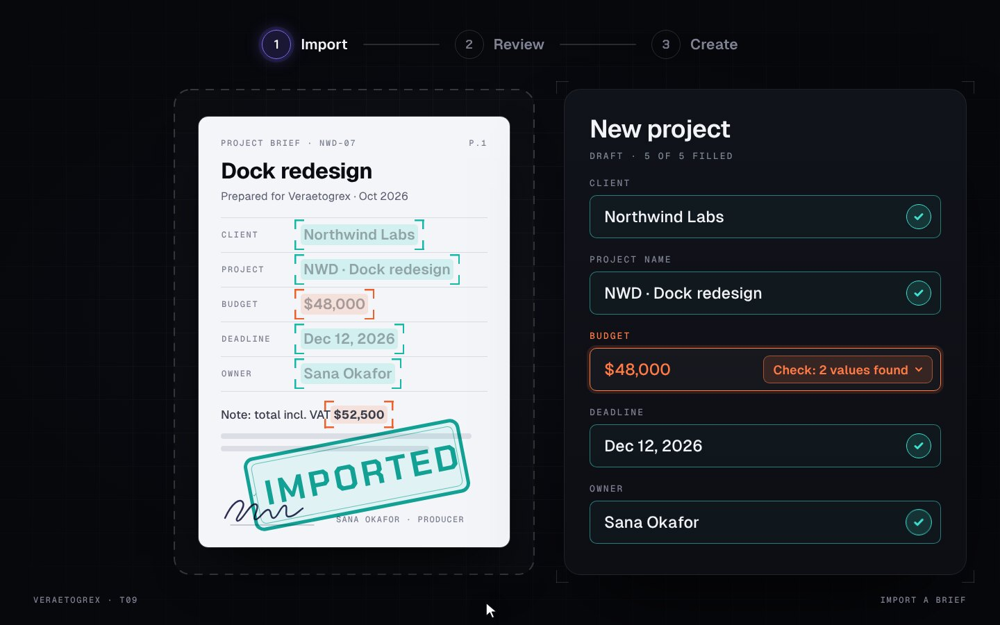

# Drop & Fill

**Drop a brief. The form fills itself.**



**Live demo:** [veraetogrex-portfolio.github.io/drop-fill](https://veraetogrex-portfolio.github.io/drop-fill/) · **Mockup:** [full-screen version](https://veraetogrex-portfolio.github.io/drop-fill/mockup/drop-fill.html)

Drop a brief on the zone: the page unfolds, a scanner reads it, and every value tears off as a chip and flies into its field. Budget has two candidate values, so it stays flagged until you pick one.

## Use it

Three files, no build step, no dependencies, no web fonts:

```
index.html   markup
style.css    styles and keyframes
script.js    behaviour
```

Download the repo and open `index.html`, or copy the three files into your project.

## Try it

- Drag the PDF thumbnail onto the zone (or focus it and press `Enter`).
- Click the flagged Budget field to choose between the two values.

## Make it yours

The parsed values are the `FOUND` object in `script.js`. Replace it with the output of your document parser. Colours are CSS custom properties at the top of `style.css`.

`prefers-reduced-motion` is respected: heavy motion drops to short fades.

## What's in `mockup/`

The full 1440×900 screen this component was shot in for the reel:

- `mockup/drop-fill.html` — interactive. `D` plays the demo, `R` resets.
- `mockup/drop-fill.autoplay.html` — the scripted ~6 s loop with a drawn cursor.
- URL flags: `?frame` puts the screen in a browser window, `?clean` hides the control panel, `?once` plays the demo once.

The mockup uses a shared stage runtime and bundled fonts from `mockup/_shared/`. The component in the root doesn't need any of it.

---

Component 09 of a series. New one every day on Instagram [@veraetogrex_portfolio](https://www.instagram.com/veraetogrex_portfolio/) · all components: [github.com/veraetogrex-portfolio](https://github.com/veraetogrex-portfolio)

MIT licensed.
